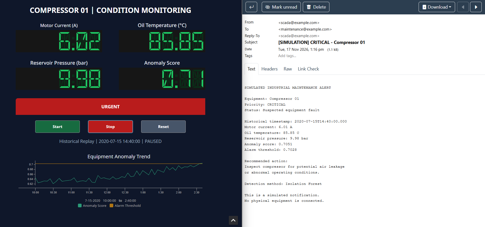
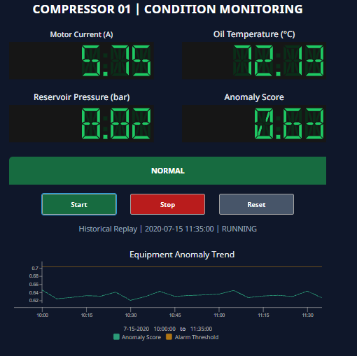
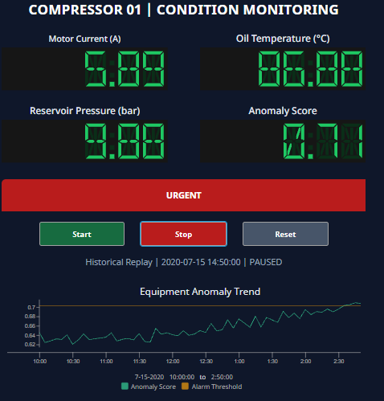
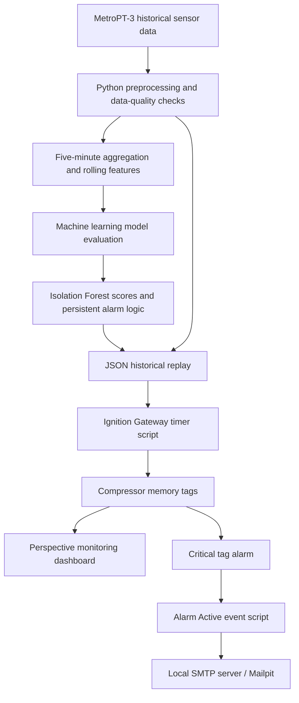
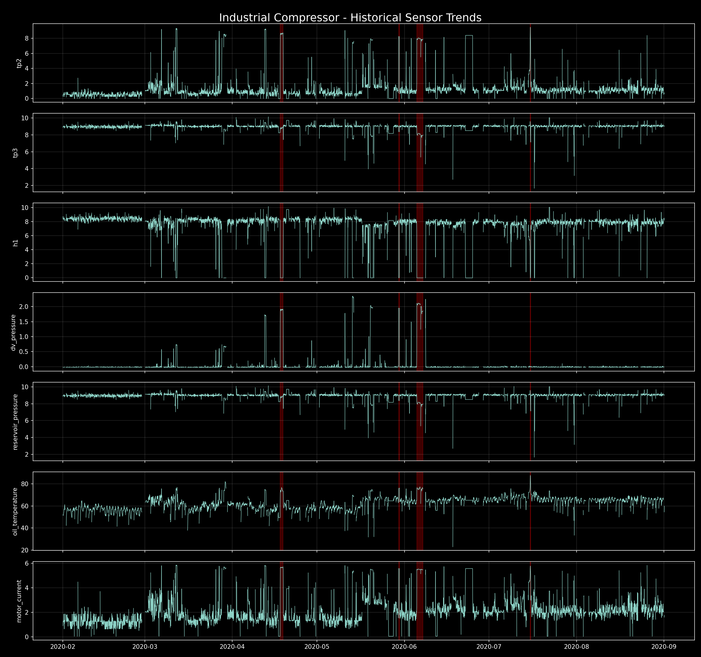
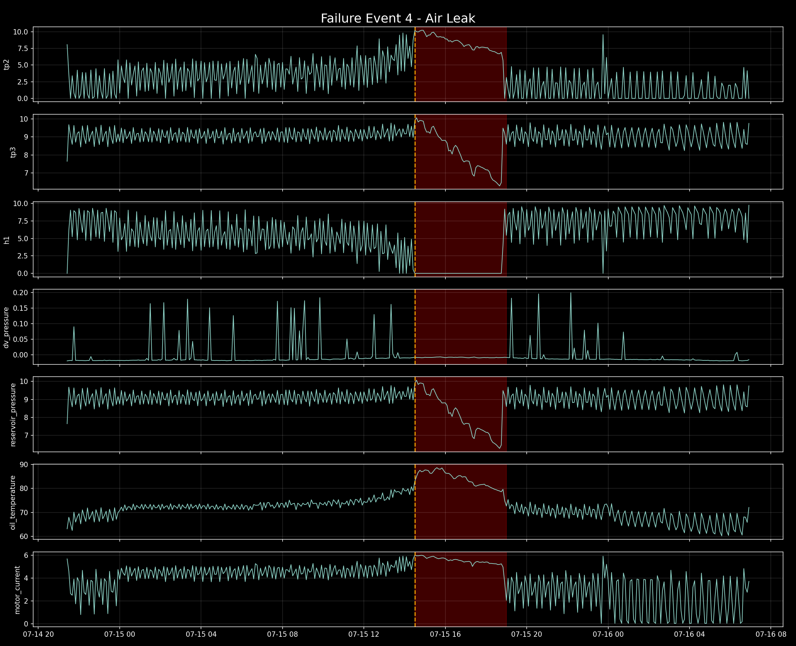

# Industrial SCADA & Machine Learning Fault Detection

An end-to-end industrial condition-monitoring prototype that combines historical compressor telemetry, machine learning, an Ignition Perspective SCADA dashboard, and automated maintenance notifications.

The project investigates whether equipment failures can be forecast from sensor data and whether abnormal operating behavior can be detected shortly after a fault begins. A historical replay of a documented air leak demonstrates the transition from normal monitoring to an urgent alarm and automatic local email delivery.

**Technology:** Python · pandas · NumPy · scikit-learn · PyArrow · Matplotlib · Ignition Perspective 8.3 · Jython · JSON · SMTP · Mailpit

## Project highlights

| Metric | Result |
|---|---:|
| Raw sensor observations processed | 1,516,948 |
| Sensor variables | 15 |
| Usable five-minute feature windows | 42,871 |
| Engineered features | 35 |
| Documented failure events | 4 |
| Final evaluation ROC-AUC (Isolation Forest) | 0.9997 |
| Detection delay for July 15 fault | 10 historical minutes |
| Available fault windows with active alarm | 88.57% (31 of 35) |
| Reference windows with active alarm | 0.0429% |
| Alarm episodes starting in reference windows | 2 |

These results are from a retrospective evaluation of one final documented failure event, not a prospective deployment or a general equipment-performance guarantee. The demonstration replays precomputed model scores; it does not run inference on live equipment.

## Demonstration

### End-to-end alarm and notification



The July 15, 2020, air leak was documented as beginning at 14:30. The model-driven alarm activated at historical time 14:40, and Ignition automatically generated an email containing sensor readings, the anomaly score (0.7051), the alarm threshold (approximately 0.7028), and a recommended inspection action. Mailpit captured the email locally; no real maintenance contact was notified.

### Operator dashboard: normal and urgent states

| Normal monitoring | Urgent fault alert |
| :---: | :---: |
|  |  |
| 11:35 historical time — normal operation | 14:50 historical time — urgent alarm, replay paused |

## System architecture



The Gateway timer advances the historical replay by five minutes approximately every two seconds. The Perspective view displays sensor values, equipment status, replay controls, historical timestamps, and an expanding anomaly-score trend. An alarm event script sends a simulated maintenance notification when the configured critical alarm enters its active state.

## Dataset

The project uses the [MetroPT-3 dataset](https://archive.ics.uci.edu/dataset/791/metropt%2B3%2Bdataset), published through the UCI Machine Learning Repository. It contains industrial air-compressor measurements from a railway pneumatic system, collected from February through September 2020. It is not oilfield or ProPetro equipment data.

Measurements include motor current, oil temperature, reservoir pressure, TP2, TP3, H1, DV pressure, and digital operating-state signals. Four documented air-leak incidents provide reference labels for retrospective evaluation.

| Event | Reported start | Reported end |
|---|---|---|
| 1 | 2020-04-18 00:00 | 2020-04-18 23:59 |
| 2 | 2020-05-29 23:30 | 2020-05-30 06:00 |
| 3 | 2020-06-05 10:00 | 2020-06-07 14:30 |
| 4 | 2020-07-15 14:30 | 2020-07-15 19:00 |

Raw data is intentionally excluded from the repository. Download it from the original source and follow its applicable attribution and licensing terms.

## Methodology

### 1. Data engineering and exploratory analysis

- Profiled 1.52 million sensor readings, checked missing values, duplicate rows and timestamps, and standardized column names.
- Converted the source CSV into Parquet and identified 331 collection gaps exceeding 30 seconds; the longest was approximately 48 hours.
- Visualized sensor behavior over time and around each documented failure; examined sensor correlations and recurring operational patterns.
- Observed sustained motor operation and elevated current during all four reported failures. Pressure decreased on average in three events. The July event also exhibited visible changes before its reported onset.





### 2. Feature engineering

Sensor data was aggregated into five-minute windows. Windows with insufficient observations or collection interruptions were excluded, rather than interpolated across gaps. Features were calculated using current and historical readings only, including:

- Motor duty cycle, average current and current variability.
- Mean, minimum and variability of reservoir pressure.
- Oil temperature and pressure-sensor measurements.
- Trailing 30-minute, one-hour and three-hour averages.
- One-hour changes in pressure, temperature, motor current and H1.

The resulting dataset contained 42,871 complete windows and 35 predictive features. TP3 was excluded from the feature set because it was nearly redundant with reservoir pressure; it remained available to the replay.

### 3. Failure forecasting experiments

Isolation Forest, Logistic Regression, Random Forest and histogram-based Gradient Boosting were compared using chronological evaluation, class weighting for supervised models, and 24-hour, six-hour and one-hour forecasting targets. Expanding-window validation was used for the May and June events. The initial 24-hour Random Forest performed poorly on the later July event (ROC-AUC 0.016, zero recall).

The data contains many sensor readings but only four documented independent failures. Adjacent windows from one failure are correlated, so thousands of observations do not imply thousands of independent training examples. Shorter prediction horizons did not produce consistently reliable forecasts.

| Forecast horizon | Best average validation ROC-AUC | Model |
|---|---:|---|
| 24 hours | 0.5459 | Gradient Boosting |
| 6 hours | 0.5356 | Random Forest |
| 1 hour | 0.5196 | Gradient Boosting |

The project therefore shifted from failure forecasting to active fault detection. Negative experimental results are retained in the reports rather than omitted.

### 4. Active fault detection

Active fault detection identifies behavior consistent with an ongoing abnormal condition instead of predicting an event that has not yet started. Isolation Forest was preferred because it achieved strong validation discrimination without requiring labeled failure examples for fitting. A simple motor-duty-cycle score was also evaluated as an engineering baseline.

| Model | Mean validation ROC-AUC | Mean average precision |
|---|---:|---:|
| Isolation Forest | 0.9686 | 0.5411 |
| Gradient Boosting | 0.9650 | 0.4459 |
| Motor Duty Cycle | 0.9415 | 0.2807 |
| Random Forest | 0.9258 | 0.4973 |

The final alarm comparison used June reference observations to calibrate thresholds and July onward for retrospective evaluation. The selected Isolation Forest threshold was approximately 0.7028. Two consecutive valid five-minute scores above the threshold were required to activate an urgent alarm. A gap interrupts the persistence rule.

| Model | Final ROC-AUC | July event detected | Detection delay | Reference alarm rate |
|---|---:|---|---:|---:|
| Isolation Forest | 0.9997 | Yes | 10 min | 0.0429% |
| Random Forest | 0.9827 | No | — | 0.6612% |
| Gradient Boosting | 0.7854 | Yes | 10 min | 1.7087% |
| Motor Duty Cycle | 0.9964 | No | — | 0.0000% |

The motor-duty-cycle threshold reached its maximum possible value (1.0); the strict greater-than alarm rule made that baseline unable to trigger. Its high ranking score should not be interpreted as an operational failure of duty-cycle monitoring itself. A revised threshold rule would be needed for a fair operational comparison.

### 5. SCADA visualization and notifications

Ignition reads historical replay records into memory tags. The dashboard displays current, oil temperature, reservoir pressure, anomaly score, the alarm threshold and the replay status. A native critical alarm on the `Urgent_Alarm` tag invokes an Alarm Active event script to send a local SMTP message to a fictional maintenance recipient. Missing model data is explicitly marked as unavailable, and the anomaly trend represents missing scores as null rather than zero. Numeric instruments may retain previously observed sensor values during missing-data periods; the readiness tags and status should be checked before interpreting them.

## Repository structure

```text
SCADA-Predictive-Maintenance/
├── scripts/          # Eleven numbered Python analysis and replay scripts
├── ignition/         # Perspective project ZIP and exported compressor tags
├── reports/          # CSV evaluations and demonstration screenshots
│   └── figures/      # Exploratory analysis and anomaly charts
├── requirements.txt  # Python environment dependencies
├── .gitignore        # Excludes data, model binaries and local software
└── README.md
```

`data/`, `models/` and the local Mailpit executable are generated, downloaded or installed locally and are not required to be committed to GitHub.

## Reproduce the project (Windows)

### Python analysis

Install Python 3 and Git, then clone or download the repository and open PowerShell in its root directory. Create the data directory, download the MetroPT-3 CSV from UCI, and place it at `data/MetroPT3(AirCompressor).csv` (rename the downloaded CSV if necessary).

```powershell
python -m venv .venv
.\.venv\Scripts\python.exe -m pip install -r requirements.txt
New-Item -ItemType Directory -Force data | Out-Null
```

Run the scripts in order:

```powershell
Get-ChildItem .\scripts\*.py | Sort-Object Name | ForEach-Object {
    & .\.venv\Scripts\python.exe $_.FullName
    if ($LASTEXITCODE -ne 0) { throw "Failed: $($_.Name)" }
}
```

This regenerates the processed datasets, trained model artifacts, evaluation reports and `data/scada_replay.json`.

### Ignition SCADA

1. Install and activate Ignition Maker Edition (non-commercial demonstration). The prototype was built using Ignition 8.3.10 with Perspective.
2. Import `ignition/Industrial_Predictive_Maintenance.zip` through Ignition's project import workflow and name the project `Industrial_Predictive_Maintenance`.
3. Import `ignition/compressor_tags.json` into the root of the `default` tag provider, creating `Compressor_01`.
4. In Designer, update the replay JSON path in both the `Compressor_Replay` Gateway Timer Script and the chart data Script Transform to the absolute location of your generated `data/scada_replay.json`. The path must be readable by the Gateway service. The repository export uses the example path `C:\SCADA-Predictive-Maintenance\data\scada_replay.json` in both scripts and starts with inactive, reset memory tags. Set both paths to your actual location (unless using the example location), and verify the import locally before starting the replay.
5. Save the project. The publication exports were sanitized outside Ignition; the original demonstration was tested, but the sanitized import has not been runtime-tested. Open `http://localhost:8088/data/perspective/client/Industrial_Predictive_Maintenance/` (adjust for your configured project name, Gateway address or port).
6. Use **Stop → Reset → Start** to run the demonstration. The documented July fault begins at 14:30, with an expected alarm at 14:40 historical time.

### Local email testing

Download [Mailpit](https://github.com/axllent/mailpit/releases) for your operating system. On Windows, extract `mailpit.exe` and run the following from its directory in a separate PowerShell terminal:

```powershell
.\mailpit.exe --listen 127.0.0.1:8025 --smtp 127.0.0.1:1025
```

Keep the process running, then open `http://localhost:8025` to view captured messages. The exported tag's Alarm Active script uses direct local SMTP at `127.0.0.1:1025` with fictional `example.com` addresses. It does not require Gmail credentials or an Ignition email profile. These settings assume Mailpit is running on the same machine as the Ignition Gateway. Do not configure message forwarding or external delivery for this simulation.

## Limitations and future work

- Only four documented failure events from one equipment dataset were available. Model selection involved retrospective analysis, including prior visual inspection of the July event. Independent equipment and prospective validation are needed.
- Reference periods are not guaranteed to be fault-free. Reference alarm rates are therefore not confirmed real-world false-positive rates.
- The replay uses precomputed scores, not streaming feature calculation or online inference. A production extension would require a validated inference service, robust data ingestion, model monitoring and safe integration with existing equipment alarms.
- Further work should evaluate alert acknowledgment, escalation, persistent alarm history, notification retries, data freshness, and operator workflows under realistic conditions.
- The demonstration is advisory only. It does not control equipment, replace safety interlocks, or establish validated industrial alarm limits.

## Acknowledgments

MetroPT-3 dataset creators and the UCI Machine Learning Repository for the documented industrial telemetry. Ignition and Mailpit are third-party tools used for this non-commercial prototype.
